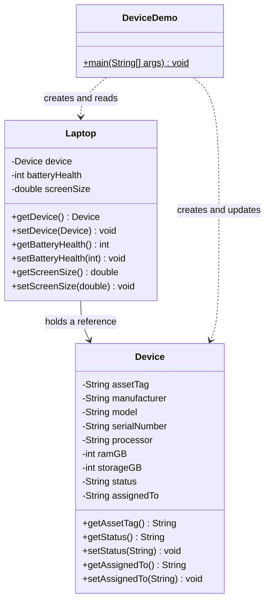
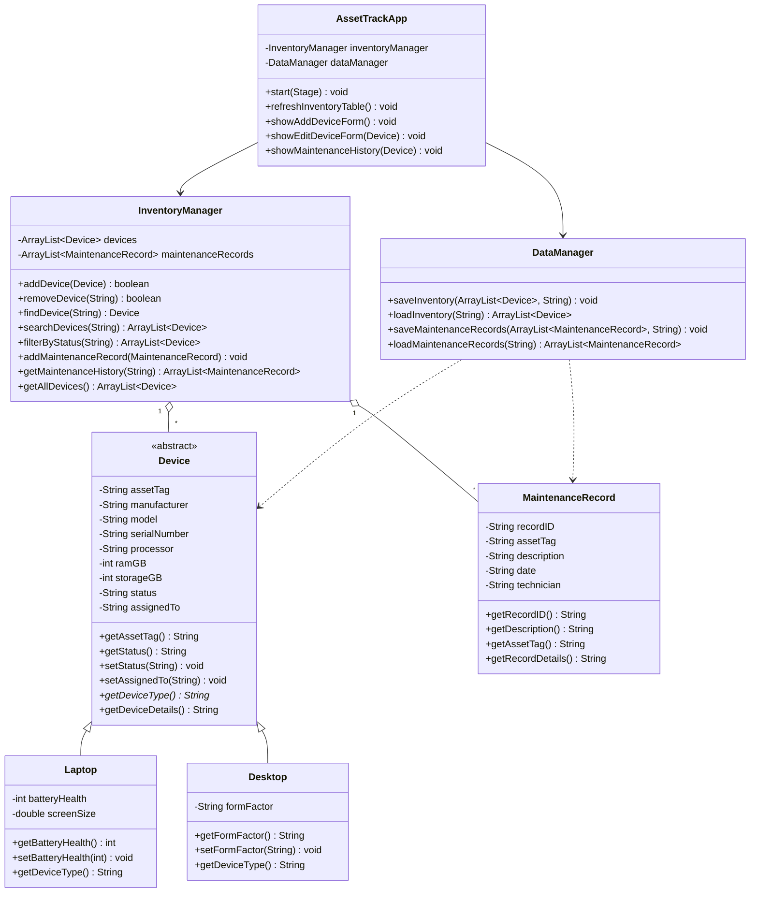

# AssetTrack: Computer Inventory Management System

**Course:** CSI 2300 - Object Oriented Computing  
**Team Name:** AssetTrack Development  
**Team Member:** Scott

## 1. Project Overview

AssetTrack is a Java desktop application designed to help IT departments organize and manage their computer inventory.

The application will allow users to register computers, record hardware specifications, track device assignments, update equipment status, and maintain basic repair records.

This project is inspired by my experience working in the OU Tech Center, where keeping accurate inventory records is important for managing equipment deployments, repairs, and replacements.

### Planned Features
- Add, edit, and remove computers from inventory.
- Track laptops and desktops separately.
- Record hardware specifications and asset tags.
- Track device status (Available, Deployed, In Repair, Retired).
- Search and filter inventory records.
- Record device maintenance history.
- Save and load inventory data locally.
- Provide a graphical interface using JavaFX.

## Current Progress — October 12, 2026

The first two core classes and a console driver are implemented:

| File | Current functionality |
|---|---|
| `Device.java` | Stores asset tag, manufacturer, model, serial number, processor, RAM, storage, status, and assignment; provides a constructor and getters/setters for all nine fields. |
| `Laptop.java` | Holds a Device reference, battery health, and screen size; provides a constructor and getters/setters for all three fields. |
| `DeviceDemo.java` | Creates a Device and Laptop, prints their information, and demonstrates updating status and assignment. |

All three files compile, and the console demonstration runs successfully. JavaFX UI design, inventory management, maintenance history, validation, and local storage remain future work. Setters currently accept values directly without enforcing ranges or status options.

### Current Class Design

The implementation uses concepts covered in the supplied course lecture slides. `Device` is a regular class, and `Laptop` holds a reference to a Device instead of extending it. This differs from the original proposal below, which used an abstract superclass.

The laptop accesses computer information through that reference, for example:

```java
laptop.getDevice().getSerialNumber()
```



The diagram shows selected Device methods; the class has a getter and setter for every field.

### Run the Console Demonstration

With a JDK installed, run these commands from the directory containing the Java files:

```bash
javac Device.java Laptop.java DeviceDemo.java
java DeviceDemo
```

The output includes the original computer information, its updated status and assignment, and the laptop's serial number, battery health, and screen size. JavaFX is not needed for this console demonstration.

## 2. Original Proposal: UML Class Design

The original proposal planned the following classes. This diagram is retained as the initial design; the current implementation and its revised relationship are documented above:

| Class | Purpose |
|---|---|
| Device (Abstract) | Stores shared computer information and behavior. |
| Laptop | Extends Device with laptop-specific properties. |
| Desktop | Extends Device with desktop-specific properties. |
| MaintenanceRecord | Stores repair and maintenance information. |
| InventoryManager | Manages devices, searching, and maintenance records. |
| DataManager | Handles saving and loading inventory files. |
| AssetTrackApp | Provides the JavaFX graphical interface. |

### UML Class Diagram


### Class Relationships

`Device` will serve as the abstract parent class, with `Laptop` and `Desktop` inheriting its shared properties and methods. Both subclasses will override `getDeviceType()`.

`InventoryManager` will maintain collections of devices and maintenance records, while `DataManager` will handle saving and loading information. `AssetTrackApp` will manage the JavaFX interface and communicate with these classes.

## 3. Development Plan

This project will be completed individually. I will be responsible for designing, programming, testing, and documenting the application.

| Phase | Task | Estimated Time |
|---|---|---:|
| 1 | Project proposal and UML design | 4 hours |
| 2 | Implement core device classes | 5 hours |
| 3 | Develop inventory management functionality | 6 hours |
| 4 | Design and implement JavaFX GUI | 10 hours |
| 5 | Implement local data storage | 5 hours |
| 6 | Testing and debugging | 5 hours |
| 7 | Documentation and presentation | 4 hours |
| **Total** | | **39 hours** |

### Project Milestones
- **October 2:** Submit project proposal and initial UML diagram.
  
### Project Milestones Upcoming
- **November 2, 2026:** Complete the UI design and screenshot, implement at least two core classes with comments, and prepare a checkpoint plan and challenges/solutions table. The two core classes are implemented; the remaining progress-report deliverables are still pending.
- **November 16:** Complete inventory management functionality.
- **November 30:** Complete application development and testing.
- **December 7–9:** Final presentation, demonstration, and GitHub submission.

## Technologies

- Java
- JavaFX
- Object-Oriented Programming
- Local file storage
- GitHub for version control and documentation

*Project developed for CSI 2300*
