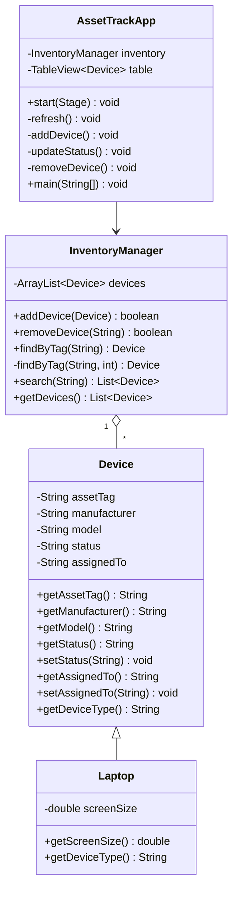

# AssetTrack Lite

**Course:** CSI 2300 Object Oriented Computing  
**Team:** AssetTrack Development  
**Member:** Scott

AssetTrack Lite is a small JavaFX desktop inventory app for tracking campus or help-desk computers. It is inspired by equipment inventory work at the OU Tech Center. This version deliberately limits scope to the course objectives and a short live demonstration.

## Features

- View sample inventory in one window.
- Add a laptop or desktop with an asset tag, manufacturer, model, status, and assignment.
- Search by tag, manufacturer, model, or type.
- Update a selected device's status.
- Remove a selected device.
- Reject duplicate asset tags.
- **Important:** data is stored only in memory and resets when the app closes. No database or file persistence is promised.

## Run

Requires **JDK 17 or newer**, **Maven**, and a desktop environment. From the repository root:

```bash
mvn clean javafx:run
```

On Linux Mint, install a JDK and Maven if needed, for example `sudo apt install openjdk-17-jdk maven`. Maven downloads JavaFX dependencies automatically. VS Code can open this repository as a Maven project.

## Course concepts

| Concept | Where to find it |
|---|---|
| Classes, objects, encapsulation | `Device.java` |
| Inheritance | `Laptop extends Device` |
| Polymorphism | `Laptop.getDeviceType()`, JavaFX Type column |
| Conditions | status validation, duplicate checks |
| Loops | inventory search, seeded records, form construction |
| Recursion | `InventoryManager.findByTag(String, int)` |
| Strings and arrays | string search, `String[][] examples` |
| GUI | `AssetTrackApp.java` (JavaFX) |

## Current UML class diagram



## Scope change from original proposal

The initial proposal included a desktop subclass, maintenance records, separate data manager, and local file persistence. The simplified implementation removes these to focus on working GUI operations and clear object-oriented examples. `Device` now represents a desktop by default, and `Laptop` inherits from it. This is a **revision of the conceptual design**, not a claim that the original proposal was implemented unchanged.

## Course submission plan

- **October 2:** Initial proposal and UML (previously submitted).
- **November 2 checkpoint:** Submit UI screenshot/sketch, core class code with comments, 2–3 milestone plan, and challenges/solutions table. See [checkpoint notes](docs/CHECKPOINT.md).
- **November 16:** Test add/remove/search/status flows and fix issues.
- **November 30:** Finalize manuals and rehearse live demonstration.
- **December 7 or 9:** Presentation/demo (assigned session).
- **December 9:** GitHub repository and documentation submission.

Read the [User Manual](docs/USER_MANUAL.md) and [Implementation Manual](docs/IMPLEMENTATION.md).

### Five-minute demo

Launch the app, show the seeded sample devices, search for `TAG003`, add a laptop, change its status, and remove it. Point out `Laptop extends Device` and the recursive `findByTag` method in the source.
