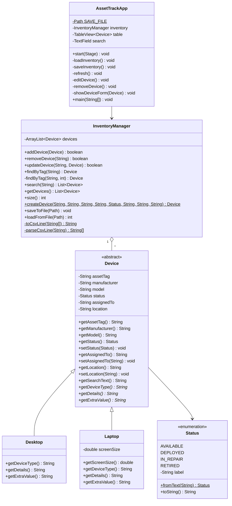

# AssetTrack

**Course:** CSI 2300 Object Oriented Computing  
**Team:** AssetTrack Development  
**Member:** Scott

AssetTrack is a JavaFX desktop inventory app for tracking campus or help-desk computers: what each device is, where it is, who has it, and what state it is in. It is inspired by equipment inventory work at the OU Tech Center. Scope is kept focused on the course objectives and a short live demonstration.

## Features

- View the inventory in one sortable table (tag, type, manufacturer, model, status, assignee, location, details).
- Add a desktop or laptop with an asset tag, manufacturer, model, status, assignee, and location.
- Enter a laptop's screen size in inches when adding or editing.
- Edit every field of a device, rename its asset tag, or switch it between desktop and laptop.
- Double-click a row to edit it.
- Search across **every** field, e.g. `in repair`, `Deployed`, a person's name, or a building.
- Remove a selected device, with a confirmation prompt.
- Reject duplicate asset tags (case-insensitive).
- **Automatic saving:** the inventory is saved to `assettrack-inventory.csv` in your home folder after every add, edit, and remove, and reloaded on the next start.

## Run

Requires **JDK 17 or newer**, **Maven**, and a desktop environment. From the repository root:

```bash
mvn clean javafx:run
```

**Running from VS Code or another IDE:** run `Launcher.java`, not `AssetTrackApp.java`. Starting `AssetTrackApp` directly gives *"Error: JavaFX runtime components are missing"*, because Java will not launch a class that extends `Application` unless JavaFX is on the module path. `Launcher` is a plain class that starts the app and avoids that check.

For a console-only example, compile with `mvn compile`, then run
`java -cp target/classes DeviceDemo`.

Run the model and save/load regression checks without JavaFX or extra test libraries:

```bash
javac -d target/checks Status.java Device.java Desktop.java Laptop.java InventoryManager.java tests/InventoryTest.java
java -ea -cp target/checks InventoryTest
```

On Linux Mint, install a JDK and Maven if needed, for example `sudo apt install openjdk-17-jdk maven`. Maven downloads JavaFX dependencies automatically. VS Code can open this repository as a Maven project.

## Using AssetTrack

1. **First launch:** the app starts with three sample devices. After that it loads whatever you last saved.
2. **Add:** click **Add Device**, fill in the form, choose **Desktop** or **Laptop**, and click **Add**. The screen size field is only enabled for laptops. Asset tag is required; invalid input shows a warning and keeps the form open so you can fix it.
3. **Edit:** select a row and click **Edit Device**, or double-click the row. Changes apply only when you click **Save**; **Cancel** leaves the device untouched.
4. **Search:** type in the search box. The table filters as you type and matches any field.
5. **Remove:** select a row, click **Remove Selected**, and confirm.
6. **Reset to sample data:** close the app and delete `assettrack-inventory.csv` from your home folder.

## Course concepts

| Concept | Where to find it |
|---|---|
| Classes, objects, encapsulation | `Device.java` (private fields, validated setters) |
| Abstract classes | `Device` is `abstract`; every device is a `Desktop` or `Laptop` |
| Inheritance | `Desktop extends Device`, `Laptop extends Device` |
| Polymorphism | `getDeviceType()`, `getDetails()`, `getExtraValue()` overridden per subclass; the JavaFX Type and Details columns and CSV saving call them without checking the class |
| Enums | `Status.java` (Available, Deployed, In Repair, Retired) |
| Conditions | status/tag validation, duplicate checks, device type selection in `createDevice` |
| Loops | inventory search, sample records, form construction, CSV reading and writing |
| Recursion | `InventoryManager.findByTag(String, int)` |
| Strings and arrays | CSV parsing in `parseCsvLine`, string search, `String[][] examples`, form label/input arrays |
| File I/O and exceptions | `InventoryManager.saveToFile` / `loadFromFile` |
| GUI | `AssetTrackApp.java` (JavaFX), started by `Launcher.java` |

## Current UML class diagram



## Course submission plan

- **October 2:** Initial proposal and UML (previously submitted).
- **November 2 checkpoint:** Submit UI screenshot/sketch, core class code with comments, 2–3 milestone plan, and challenges/solutions table.
- **November 16:** Test add/remove/search/status flows and fix issues.
- **November 30:** Finalize manuals and rehearse live demonstration.
- **December 7 or 9:** Presentation/demo (assigned session).
- **December 9:** GitHub repository and documentation submission.
