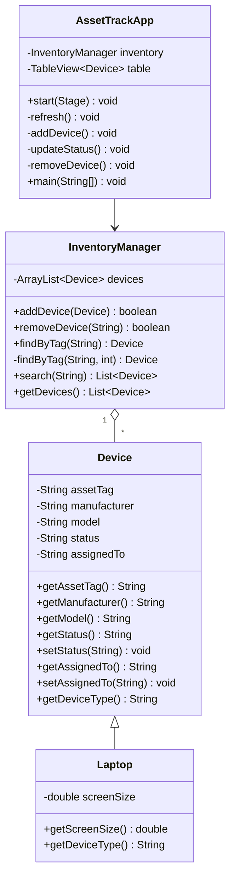

# AssetTrack Lite

**Course:** CSI 2300 Object Oriented Computing  
**Team:** AssetTrack Development  
**Member:** Scott

AssetTrack Lite is a small JavaFX desktop inventory app for tracking campus or help-desk computers. It is inspired by equipment inventory work at the OU Tech Center. This version is downscaled from my original plan, allowing the final project to be done but in a smaller scale

- View sample inventory in one window.
- Add a laptop or desktop with an asset tag, manufacturer, model, status, and assignment.
- Search by tag, manufacturer, model, or type.
- Update a selected device's status.
- Remove a selected device.
- Reject duplicate asset tags.
- **Important:** data is stored only in memory and resets when the app closes. No database or file persistence is promised.

## Run

Requires **JDK 17 or newer**, **Maven**, and a desktop environment. From the repository root:

```bash
mvn clean javafx:run
```

On Linux Mint, install a JDK and Maven if needed, for example `sudo apt install openjdk-17-jdk maven`. Maven downloads JavaFX dependencies automatically. VS Code can open this repository as a Maven project.

## Current UML class diagram



## Course submission plan

- **October 2:** Initial proposal and UML (previously submitted).
- **November 2 checkpoint:** Submit UI screenshot/sketch, core class code with comments, 2–3 milestone plan, and challenges/solutions table.
- **November 16:** Test add/remove/search/status flows and fix issues.
- **November 30:** Finalize manuals and rehearse live demonstration.
- **December 7 or 9:** Presentation/demo (assigned session).
- **December 9:** GitHub repository and documentation submission.
